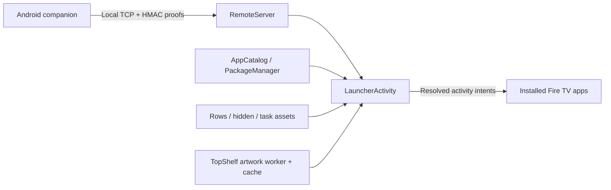

# Architecture

## TV application

`LauncherActivity` owns row navigation, focus restoration, loading feedback, intent dispatch and the remote server lifecycle. `AppCatalog` queries launchable exported activities with Leanback priority, excluding unavailable or protected entries. Launch intents preserve the selected category and resolved component. Prime Video's standalone app is preferred to its internal player.

Package discovery, artwork rasterization and dominant-color extraction run at startup on a worker. `TopShelf` uses one backdrop ImageView, a 150 ms delayed update after focus settles, small RGB_565 textures and an LruCache. Tile artwork is flattened ahead of drawing. TileButton is a single Button drawing pre-rendered artwork and a reusable focus outline, rather than the planned ImageView-only implementation. Focus-path allocations and some nested containers remain; this is not a zero-allocation renderer. Lazy row Views are created on the UI thread when reached.

`HomeService` is experimental. Its intended key handling is immediate single HOME, double HOME within 350 ms to stock Home, and a two-second suppression window. It resolves the system Home component rather than hardcoding one. The service did not bind successfully on the tested firmware and is not part of the supported installation flow. There is no separate service process, polling or periodic key scan.

## Companion and protocol

`RemoteActivity` submits commands through a bounded single-worker queue. `Link` implements challenge-response messages over TCP 48321. Pairing uses a 16-character random code, a two-minute window, a random phone identifier and an HMAC-derived per-phone key. A fresh server nonce is included in each authenticated request; replies carry an authenticated acknowledgement. Keys are stored in app-private preferences; backup is disabled in the manifests.

The protocol authenticates messages but does **not** encrypt the TCP connection and has not undergone an independent security audit. Pair only on a trusted local network. Do not expose the server or ADB via router port forwarding. No cloud service or account is required for the companion protocol.

The server exists only while the launcher is started and closes when it stops. This intentionally avoids a persistent remote-control background service but limits remote usefulness after opening another app. Phone Back/Home manipulate Family TV only while it is available; they do not inject system-wide events. Volume and mute remain disabled controls.

Generated backdrops now use a small private disk cache with a sampled icon/color fingerprint; user override paths are unchanged. Artwork generation and cache I/O stay on the startup worker. Shutdown places cache eviction behind outstanding work so it cannot be repopulated after final cleanup. The local remote queue drops commands older than 750 ms before connecting; changing endpoints invalidates queued commands and old UI callbacks. TV callbacks also carry a server-session guard.
