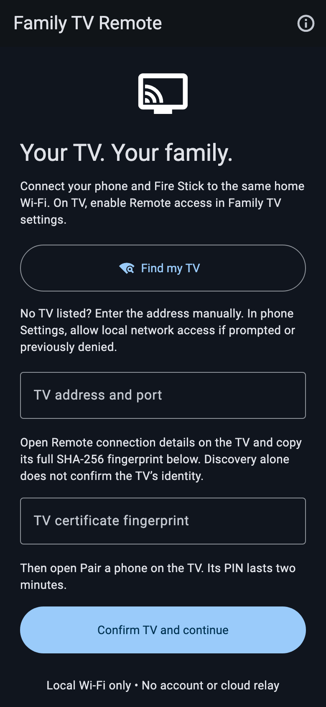

# Day 4 implementation review — 2026-11-18

Owner approved publication on 2026-11-18. Source delivered in four checked increments; physical acceptance remains pending. Issue #4: https://github.com/DarkCodexUser999/family-tv/issues/4. Source baseline 2e21cd3. The TV source, launch strategy, hidden-app/row assets, loading state and restore script are unchanged.

## Implemented

Flutter Android/iOS hosts and shared dark, readable UI: discover TV/manual address, TV certificate fingerprint confirmation, PIN/name entry, typed error/retry states, paired screen, saved-unverified connection, forget-local confirmation and license access. All network and secure storage dependencies are injectable for testing. Discovery is explicitly requested, limited to a short foreground scan, capped at 16 displayed candidates, stopped on pause, and late registrations are cleaned up.

Private RFC1918 IPv4 only, explicit port, HTTPS only, no arbitrary path/query/credentials/redirect/proxy. HttpClient uses an empty trust root context and an exact SHA-256 DER pin (including certificate validity), before request body transmission. Connection timeout 4 s, total request deadline 8 s, response cap 16 KiB, pair request <=1024 UTF-8 bytes. No POST retry. The PIN is obscured/cleared in UI and not persisted. Token, certificate fingerprint, endpoint, installation/device IDs are saved as one platform-secured record and read back before reporting success. Android backups/cleartext are disabled; iOS Keychain is non-syncing/device-only. Existing saved pairing does not assert TV reachability or token validity.

Day 3's GET /v1/info and POST /v1/pair are consumed without changing the TV protocol or launch code. There is no WSS, D-pad, apps grid, system-wide navigation, volume/power or new launcher feature in Day 4.

## Evidence

- Flutter analyzer clean; 14 tests passed: endpoint/model guards, duplicate pairing, storage failure, permission recovery, PIN rejection/success, saved-state honesty, six real loopback HTTPS tests, and a phone-size render/200%-text scrolling check.
- Real HTTPS tests preserve the production certificate callback/context and route only test TCP sockets to loopback. Matching certificate permits info+pairing; wrong pin blocks HTTP and PIN transmission; oversized response, redirect and rate-limit cases reject safely. Synthetic credentials only.
- iOS plist/entitlements and Podfile syntax pass; this is NOT an iOS build.
- Existing Java checks (47 TLS guards, 30 pairing checks, 13 discovery fake callbacks), 27 protocol fixtures and both existing signed Android APK builds pass.
- Flutter Android debug APK built successfully from the clean APFS workspace; APK v2 signature verified. Package app.familytv.family_tv_remote, min API 26, target API 36; arm64-v8a/armeabi-v7a/x86_64. Reviewed local artifact (before publication snapshots): mobile/build/app/outputs/flutter-apk/app-debug.apk (166318956 bytes); SHA-256 d1b7dfa84ffbb1c5705e20af240841bb27c49a6b135ae70e54b4aefb51c80d0a. Bundled Tink license verified in the APK. Debug build size is not a release-size measurement.
- Merged permissions: INTERNET, CHANGE_WIFI_MULTICAST_STATE and AndroidX's app-scoped signature receiver permission. Signing key is under external tools/android-user/debug.keystore. No device/emulator installation or actual Android/iOS plugin execution is claimed.
- Each exact staged snapshot passed applicable Flutter analyzer/tests, Java/protocol checks and all three APK builds before commit/push. Existing GitHub CI covers Java/protocol/legacy APKs; Flutter CI expansion is a later milestone. Final CI evidence is linked from the project card after completion. No new Flutter CI or physical evidence is claimed.

## Storage/toolchain and recovered setup failures

Source remains /Volumes/ExSSD/FireTvRemote/repo/mobile. Pub/Gradle/Flutter/NDK live on the SSD-backed FamilyTVTools APFS image; the SDK view there links existing ExSSD SDK platforms/build tools. ExFAT cannot represent NDK links and macOS ._ files broke Android resource/test discovery. We did not format or erase the drive: verified Google's NDK archive checksum, extracted on APFS, used a clean generated APFS Android build workspace, and explicitly named Dart tests. The APK is copied back to mobile/build/app/outputs/flutter-apk/app-debug.apk. scripts/build-mobile.sh deletes only its own mktemp workspace. Gradle archive SHA-256 is pinned; initial Java download timeout was recovered by checksum-verified cache seeding from the official distribution.

macOS preferences/temporary files and existing system JDK remain internal. No full Xcode, emulator or paid tooling was installed. iOS sources include Bonjour privacy and Keychain capability, but Xcode/signing/simulator/phone validation is pending. The screen capture is an actual widget render with test dependencies, not a claim about Fire TV or phone behavior.

## Approved publication

1. chore: scaffold pinned Flutter phone hosts and SSD build workflow — generated Android/iOS hosts, package lock, minimal app/theme and wrappers.
2. feat: add private pinned HTTPS pairing and secure credentials — models/client/storage/discovery adapter and TLS tests.
3. feat: add TV discovery and PIN pairing screens — controller, first-run and recovery states and UI tests.
4. test: verify accessible pairing flow and record day four evidence — host render, test runner, dependencies/setup/progress and project card.

Four cohesive working snapshots, each tested/built before commit and immediately pushed following owner approval. Generated scaffolding, its lock file and cohesive security/UI tests legitimately exceed ~100 lines; no fake/filler commits. Code commits: 9fc348c (1), ff302fd (2), f522a20 (3); this test/documentation update is the fourth approved increment. No history rewrite. Actual platform pairing, iOS build/LAN consent, phone storage, background/foreground discovery and Fire OS performance remain open gates; keep issue #4 open while essential acceptance is unverified. Next day requires its own briefing/go.

The original 8 GiB tools image filled during the first full build and was safely grown offline to 16 GiB on 2026-11-18, preserving its files. This changes only the sparse tools image on ExSSD, not the physical drive format.

During publication Git misread two AppleDouble ._ pack-index sidecars as Git indexes. Their AppleDouble signature was verified and the sidecars moved reversibly to tools/day4-publication/mac-metadata-backup outside the repository. Actual pack indexes and history were preserved; subsequent pushes were clean.
