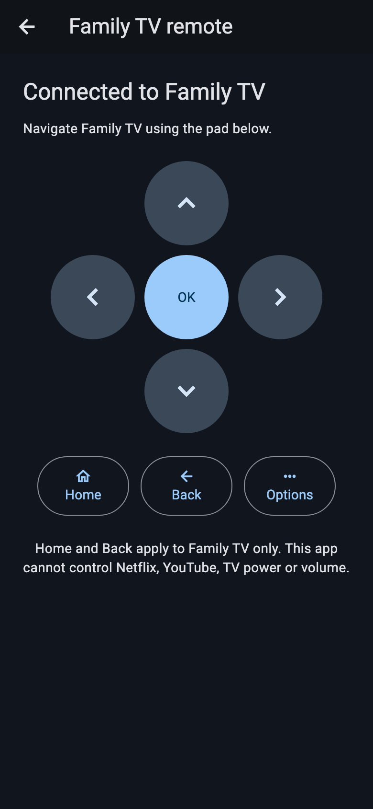

# Day 5 local review — 2026-11-19

Issue #5: https://github.com/DarkCodexUser999/family-tv/issues/5. Owner approved three-commit publication on 2026-11-19. Baseline ed46e38. Physical acceptance remains pending; no device installation is claimed.

## What changed

The paired Flutter app now opens a remote pad: UP/DOWN/LEFT/RIGHT/OK, Family TV HOME/BACK and OPTIONS. Visible pending feedback blocks repeated input until its acknowledgement. Buttons disable while Family TV is backgrounded or opening an app. Home/Back cannot bring Family TV out of another app; use the physical remote. No volume/power or other-app injection was added.

The TV caches lifecycle, launch-busy state and the focused package in LauncherBridge. Authenticated WSS `/v1/events` supplies an initial/current `state`, then coalesces changes; `/v1/status` exposes a minimal cached snapshot (catalogRevision=0 and tmdbConfigured=false until those features exist). The existing handlers receive eight semantic actions only while foreground. Launch intents, per-app flags/config, hidden list, BACK handling, loading presentation and restore script are preserved. Native legacy `/remote` remains incompatible with the new transport.

A cached focus reference is the only new disabled/no-phone focus-path operation: no allocation, PackageManager call, bitmap work or I/O. With connected phones, focus also marks a coalesced event dirty and notifies the writer; serialization and socket writes happen off the UI thread. This design is not a measurement of Fire Stick performance.

## Bounds and security

- Retain private-interface-only, default-off TLS, exact phone certificate pinning and bearer authentication before upgrade; reject Origin/query tokens/subprotocols and invalid handshake keys.
- At most two upgraded phones, one connection per phone, plus two HTTP workers. One shared event writer sleeps awaiting changes. One shared deadline executor handles one-shot read/write timeouts; it expires its idle thread. No heartbeat, polling, extra process or background phone reconnect.
- Maximum 4 KiB complete masked text frames; fragmentation/binary rejected before payload allocation. Partial-frame deadline 2 s, output-write deadline 1.5 s, <=40 frames/s/client. Complete frames cancel their timers; an otherwise idle socket has no frame timer.
- At most eight globally queued inputs, eight replies per phone, coalesced state, last 64 IDs/phone with ten-second expiry, eight paired phones. Inputs <=20/s/phone and <=30/s globally. Queue/rate rejection is explicit; slow readers disconnect. Revoke-all closes live sessions and invalidates pending actions.
- Commands carry matching IDs, monotonic server-clock timestamp and lifecycle epoch. Expire after 500 ms at arrival and dispatch; reject >50 ms future time, stale epochs, paused/busy UI and disconnected peers. Duplicate IDs still in that bounded cache return the prior result without executing again.
- Phone estimates server time using the latest state plus a local Stopwatch, keeps one command in flight and gives up after 450 ms without replay. Connection/state deadlines are bounded. Reconnect uses 1/2/4 s delays, maximum three consecutive failures while foreground; new state is required. Successful reconnection restores current state, never pending input. Backgrounding cancels retries and closes its session.

NanoWSD 2.3.1 source is vendored with its BSD-3-Clause notice and small framing/deadline patches; no new runtime JAR/native library. See protocol/THIRD_PARTY.md. This old library and the changes have not received an independent security audit.

## Executable evidence

- Analyzer clean; 21 Flutter tests pass, including input feedback, duplicate suppression, timeout/disconnect/reconnect, late-event rejection, foreground unavailable state and 390x844/200%-text rendering.
- An additional real host interoperability test passes: the production Dart pinned WSS connector talks to the production Java transport on a private host interface; fake launcher UI records RIGHT/OK, rejects background HOME and disconnects after revocation. This is not an emulator or Fire TV test; certificates/credentials are synthetic and outputs ignored.
- Existing regressions pass, plus 47 TLS/transport guards, 30 pairing checks, 13 host-fake discovery checks, 29 bridge/expiry/bounds checks and 45 real TLS/WSS checks. Coverage includes two phones plus HTTP, slow output, partial frames, oversize-before-body, shutdown, duplicate OK and revoked sessions.
- Protocol: 9 positive and 20 negative fixtures pass, as do actual emitted WSS state/ACK schema checks. WSS now requires timestamp/epoch; planned HTTP action contract is unchanged and unimplemented.
- All three Android APK builds and signature checks pass. Launcher retains min API 22; Flutter min API 26. No iOS native build, TV/phone/emulator install, NSD device result, sign-in test, PSS or input/launch timing measurement is claimed.
- Build caught and corrected an illegal Java forward reference; rendered preview caught and corrected the narrow Options label. Integration harness classpath/cleanup and Dart lint issues were corrected before final checks. A final review also closed the authenticate-to-upgrade revocation race by reserving peers under the pairing-store lock. No published history was rewritten.

## Review and remaining acceptance

Three publication groups: (1) bounded WSS, cached bridge and expiring dispatch with host tests/contracts/license; (2) pinned Flutter remote pad and finite reconnect; (3) production integration, interoperability tests, preview and evidence. Security state machines and upstream source exceed the rough 100-line guideline; they are not split into artificial contribution-only commits. Integrated source passed the full local checks and three APK builds before publication. The first two staged snapshots were checked again; final integration/evidence uses the completed review results without another rebuild. User explicitly authorized publication; future approved workdays follow test, push, board update, stop project tools and safe ejection.

Existing CI automatically runs Java/WSS/protocol and the two native APK builds via updated check-lan.sh; actual CI state and commit links are recorded on the live project card; no pending run is claimed successful; Flutter CI expansion remains planned for Day 13. Manual host interop requires a private IPv4 interface and JDK17; it explicitly skips if no private interface exists.

Before physical acceptance: install signed compatible APKs without clearing data; pair over actual Wi-Fi; verify all eight commands inside Family TV, press OK once and confirm one launch, observe disabled pad inside YouTube, return with physical remote, disconnect/reconnect mid-OK and revoke from TV. Measure same-build disabled/enabled/connected PSS and focus/launch latency on API22. Keep issues #2–5 open while these gates remain unavailable. Do not promise zero measurable overhead or a stable release from host evidence alone.

## Reviewed local artifacts

Development-signed outputs are ignored by Git; these checksums identify this local review, not a release.

| APK | Bytes | SHA-256 |
|---|---:|---|
| launcher/build/local/family-tv-debug.apk | 99164 | b18c9d42aff33c2f1745aedf0e0c3f76c725efbfc99a5829b5d1df7bec001f6f |
| remote/build/local/family-tv-remote-debug.apk | 16811 | 0bb933a63f3cdb63f179a39f9a58f659f15f58f8f6e3c03810bcc45be90d276a |
| mobile/build/app/outputs/flutter-apk/app-debug.apk | 166340504 | bf8f25c705f2d4cdb9106c467ba82bdbedd4415fbda10d2fa177da6079456fb1 |

## Approved source increments

- [0a8e1f0](https://github.com/DarkCodexUser999/family-tv/commit/0a8e1f026c2b6016595e95cd572128e6577db995): feat: add bounded authenticated WSS event and action transport
- [d94b8d1](https://github.com/DarkCodexUser999/family-tv/commit/d94b8d1cd23748fe76eda234f43befa0d8ab364f): feat: add pinned Flutter remote pad with bounded reconnect

This evidence/interoperability update is the third approved increment. The public project card records actual CI state; the final publication run may still be pending. Essential physical gates keep issue #5 open.
